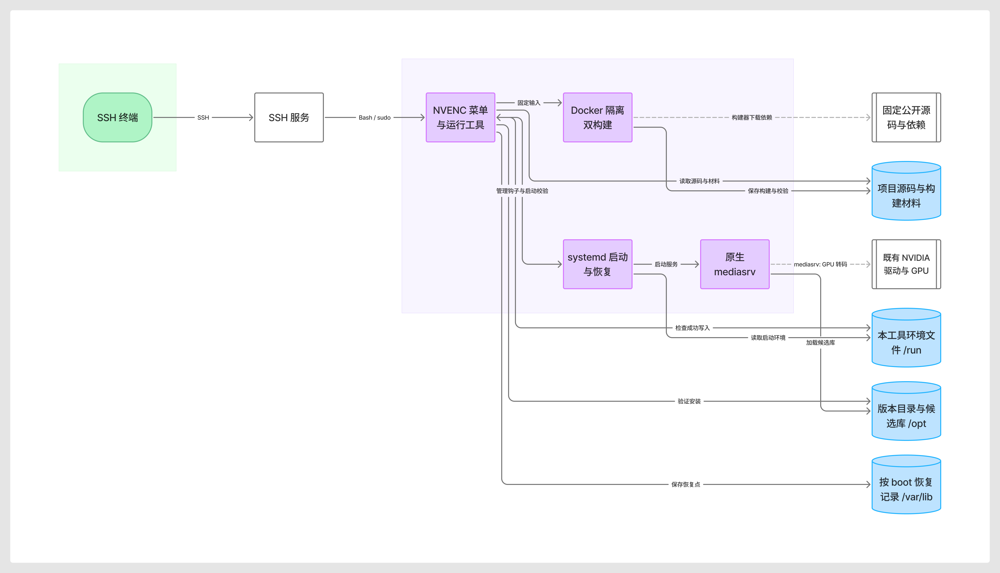

# Solis fnOS NVENC 架构与文档导航

本页说明模块关系、交付边界和阅读入口。项目意图以[项目蓝图](docs/blueprint.md)为唯一权威，安装步骤见 [README](README.md)，验证事实见[验收报告](docs/installer_report.md)。

## 架构概要

| 模块 | 职责 |
| --- | --- |
| [fnos-nvenc.sh](fnos-nvenc.sh)、[nvenc_cli.py](scripts/nvenc_cli.py) | SSH 编号菜单、命令行兼容与标准 sudo 入口 |
| [nvenc_build.py](scripts/nvenc_build.py)、[容器构建入口](build/run_public_build.sh) | 固定公开来源校验、Docker 双构建及候选身份门 |
| [nvenc_install.py](scripts/nvenc_install.py)、[nvenc_bootstrap.py](scripts/nvenc_bootstrap.py) | 版本目录、文件清单、原子指针及执行前校验 |
| [nvenc_migrate.py](scripts/nvenc_migrate.py) | 更新时核实既有材料，登记原归属清单，列明保留的未知材料 |
| [nvenc_autostart.py](scripts/nvenc_autostart.py) | 每次服务启动检查、本次开机恢复点、事务阶段及锁交接 |
| [nvenc_runtime.py](scripts/nvenc_runtime.py) | 组件检查、单库接入、实际映射核对、消费者检查和回退 |

公开构建在宿主下载并校验输入，在 Docker 内准备依赖和编译。候选库必须与固定身份一致，再经安装清单接入原生影视。工具版本用普通 JSON 指针原子切换，不使用符号链接。

永久启用同时要求当前运行合同与安装／服务启动验收通过；未验收组合只接受有效的有界试用。启动检查失败时清除自有注入，每次开机独立保存恢复点。原菜单 **7／8** 先核对实际恢复、材料身份和消费者，再移除已登记安装材料并读回残留；未知材料保留并停止。完整规则见[维护说明](docs/maintenance.md)。

## 项目架构图

[Figma 可编辑原图](https://www.figma.com/board/3tIHKaCHRA2wdciTQZij3B) · [Mermaid 定义](docs/assets/project_architecture.mmd)

图示表达职责和材料流，项目仍是原生 mediasrv 辅助工具。源码与生成材料位于 `/vol1/1000/Solis_FnOS_NVENC/`，安装、恢复和临时启动状态分别使用 `/opt`、`/var/lib`、`/run`。

## 责任边界

本工程维护应用层单库兼容、安装、检查和恢复。Solis_Pvescript 继续维护 PVE、vGPU、Guest 驱动与 Toolkit，NVIDIA License 保持原责任边界。旧 AC4 demux、多库及配套媒体实验能力已退役。

源码、构建、隔离软件测试、现场映射与人工播放是独立证据层；已加载候选不等于当前影片已通过。完整原版功能对等仍失败，未覆盖格式与长期稳定性仍未验证。

## 按需要阅读

文档按读者任务区分用途，沿用现有文件。分类参考 [Diátaxis](https://diataxis.fr/)，不额外建立四套目录。

| 文档 | 主要用途 | 读者 | 状态 |
| --- | --- | --- | --- |
| [README](README.md) | 入门与操作：首次安装、播放、更新、暂停和卸载 | 用户 | 现行 |
| [快速使用说明](docs/quick_start.md) | 操作：随工具安装的离线速查 | 已安装用户 | 现行 |
| [维护说明](docs/maintenance.md) | 操作：验证、故障恢复、材料管理和文档约定 | 维护者 | 现行 |
| [验收报告](docs/installer_report.md) | 参考：各版本有限验证、现场记录、已知问题和缺口 | 用户、维护者 | 截至 2026-10-15 |
| [来源与边界](docs/source_and_evidence.md) | 参考：输入来源、许可、必要旧结论及证据限制 | 维护者 | 现行 |
| [项目蓝图](docs/blueprint.md) | 原理说明：唯一项目意图、范围与非目标 | 用户、负责人 | 现行 |
| [项目规则](AGENTS.md) | 参考：执行授权与维护约束 | 负责人 | 现行 |
| [单库完成报告](docs/completion_report.md) | 参考：身份合同引用的原单库证据 | 工具、维护者 | 固定历史证据 |

## 目录与固定材料

`docs/` 保存中文说明和配图，`scripts/` 保存运行模块，`tests/` 保存验证入口，`patches/` 保存正式补丁与许可。构建脚本与输入集中在 `build/`，程序读取的固定事实集中在 `metadata/`；它们随源码保留，不能按临时文件清理。

| 文件 | 权威职责 |
| --- | --- |
| [metadata/runtime_profile.json](metadata/runtime_profile.json) | 组件、依赖及候选身份合同 |
| [build/build_sources.json](build/build_sources.json)、[build/build_packages.txt](build/build_packages.txt) | 固定公开来源和依赖版本 |
| [metadata/materials.json](metadata/materials.json) | 原样材料身份及整理代码的来源映射 |
| [metadata/historical_checks.json](metadata/historical_checks.json) | 必要旧检查计数与缺失 codec 名单 |
| [metadata/installer_status.json](metadata/installer_status.json) | 当前合同的有限安装及服务启动验收门，不代表实时状态；整机重启结论单列 |

`completion_report.md` 保留旧合同及恢复材料引用的路径和证据正文，其中旧私人包已退役；当前合同引用安装器报告，操作以现行手册为准。TODO.md 和 DEVLOG.md 是 Git 忽略的本地行动与维护记录。旧过程报告和计划不再单独保留。

架构、接口、交付边界或文档职责变化时更新本页；验证事实进入验收报告，项目意图变化才更新蓝图。写作约定见[维护说明](docs/maintenance.md#中文文档维护约定)。
